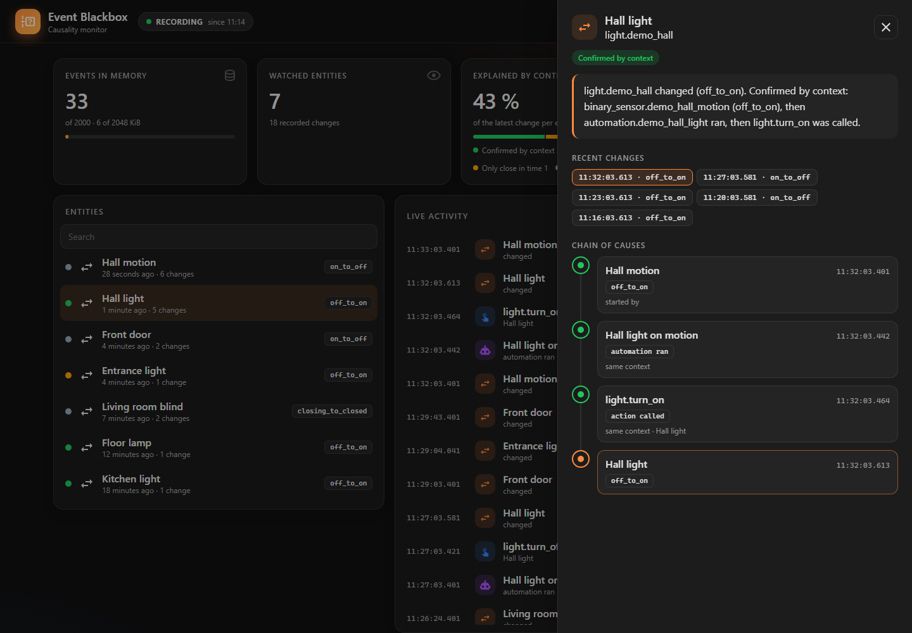
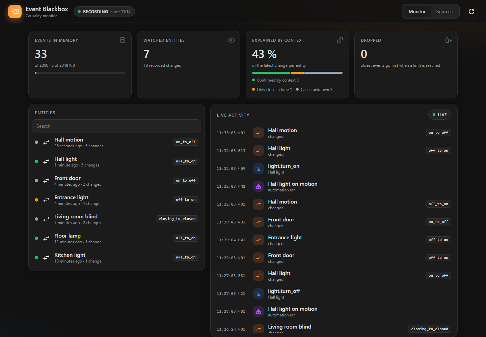
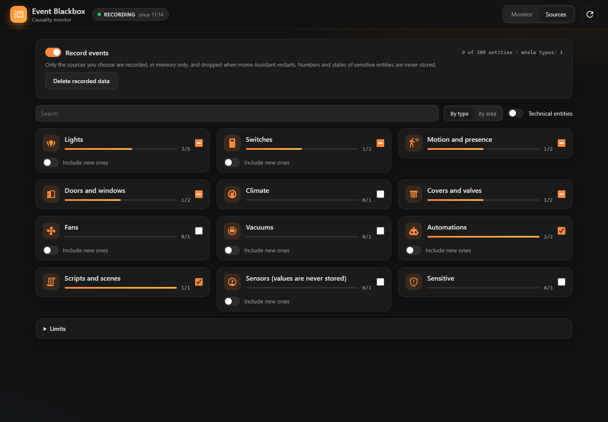
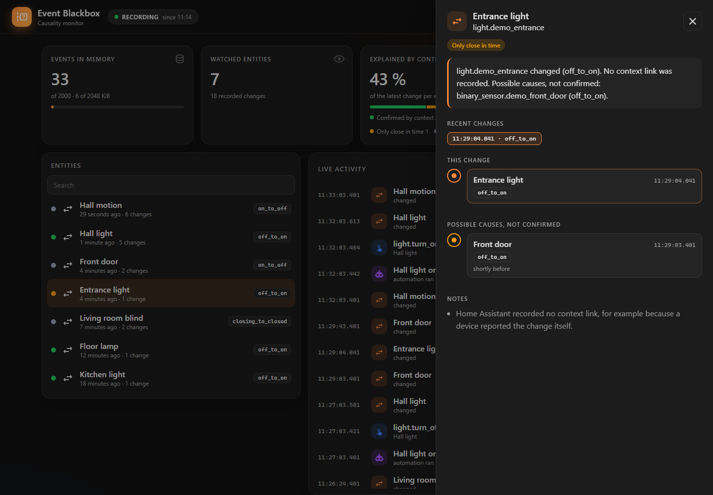

  <picture>
    <source media="(prefers-color-scheme: dark)" srcset="docs/images/logo-dark.png">
    
  </picture>

  Find out why an entity changed. Event Blackbox records what happens around your
  devices and automations and tells you how sure it is about the cause.

Event Blackbox is a custom integration for [Home Assistant](https://www.home-assistant.io/).
It answers questions like "Why did the hall light turn on at 02:17?" by following the
context that Home Assistant attaches to its events: the motion sensor that triggered
an automation, the automation that called an action, and the action that switched
the light. Every link is labelled with its evidence:

| Evidence | Meaning |
|---|---|
| Confirmed by context | Home Assistant linked the events through their context. |
| Only close in time | The events happened shortly after each other, but nothing links them. A hint, never proof. |
| Cause unknown | The recorded events do not explain the change. |

Event Blackbox only observes. It never calls actions, never controls devices and
never sends data anywhere. It is a debugging tool for your automations, not a tool
to monitor people.

## Features

- **Monitor:** a sidebar panel with the recording state, key figures, a live activity
  tape and all recorded entities, each with the evidence of its latest change.
- **Explanations:** pick a change and see its chain of causes as a timeline, with the
  confirmed links, possible causes that are only close in time, and plain-language
  notes, for example when a device reported the change itself.
- **Sources:** choose what to record, grouped by area or by type, with search and
  "select all" per group. Technical entities stay out of the way.
- **Privacy by default:** nothing is recorded until you turn it on. Events stay in
  memory, limited by count, size and age. Numbers such as temperatures and the states
  of people, locks, cameras and similar entities are never stored.
- **Optional history:** keep the recorded events for up to 7 days across restarts,
  off unless you turn it on.
- **Action** `event_blackbox.explain` for scripts and the developer tools.
- English, German and Greek.

| Monitor | Sources |
|---|---|
|  |  |

When nothing links a change to its cause, Event Blackbox lists what happened shortly
before and says clearly that it is not confirmed:

Requires Home Assistant 2026.9 or newer.

## Installation

### HACS

1. In HACS, open the menu in the top right corner and choose **Custom repositories**.
2. Add `https://github.com/Rafail-Mathiou/ha-event-blackbox` with the type
   **Integration**.
3. Install **Event Blackbox** and restart Home Assistant.
4. Open **Settings**, **Devices & services**, **Add integration** and choose
   **Event Blackbox**.

### Manual

1. Copy `custom_components/event_blackbox` into the `custom_components` folder of your
   Home Assistant configuration.
2. Restart Home Assistant and add the integration as described above.

## Getting started

1. Open **Event Blackbox** in the sidebar and switch to **Sources**.
2. Choose what to record. Group by type or by area, search, or select whole groups.
   A good start is a few lights and the motion sensors and automations that switch
   them.
3. Turn on **Record events** and save.
4. Wait until something happens, then switch to **Monitor**. Pick an entity to see
   why it changed.

The panel is only visible to administrators. The same settings are also available
under **Configure** on the integration.

### Settings

| Setting | Default | Meaning |
|---|---|---|
| Record events | off | Nothing is recorded while this is off. |
| Entities and types | none | Only these are recorded. Up to 200 entities; a whole type can include entities added later. |
| Maximum events | 2,000 | Oldest events are dropped first when the limit is reached. |
| Maximum memory | 2 MiB | Same, by estimated size. |
| Maximum age | 30 minutes | Older events are dropped. |
| Keep history across restarts | off | 1 to 7 days in Home Assistant's storage. |

Selecting people, device trackers, cameras, locks, alarm panels or media players asks
for an extra confirmation.

### Asking from scripts

The action `event_blackbox.explain` takes an `entity_id` and returns the explanation of
its latest recorded change as a response, for example in **Developer tools**,
**Actions**. It is restricted to administrators.

## Privacy

- Everything stays inside your Home Assistant. No cloud, no telemetry, no network
  access.
- Only a few fields of each event are kept: the entity, the kind of change, the time
  and Home Assistant's context IDs. Numbers, attributes, action data and the user who
  started an action are never stored.
- With the optional history on, these reduced events are also written to
  `.storage/event_blackbox.history`. The file is not encrypted and is part of your
  backups. It is deleted when you turn history or recording off, when you remove the
  integration, or with **Delete recorded data** in the panel.
- Diagnostics contain counters only.

Details are in [docs/PRIVACY.md](docs/PRIVACY.md).

## Limits

Home Assistant does not link every change to its cause. A device that reports a change
itself, a change made from the device's own app, or feedback that arrives more than a
few seconds after an action carries no context link. Event Blackbox then says so
instead of guessing. How the evidence is decided is described in
[docs/ARCHITECTURE.md](docs/ARCHITECTURE.md).

## Development

See [docs/DEVELOPMENT.md](docs/DEVELOPMENT.md) and [CONTRIBUTING.md](CONTRIBUTING.md).

## License

MIT, see [LICENSE](LICENSE).
