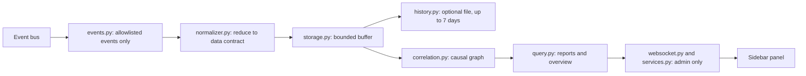

# Architecture

Event Blackbox is a Home Assistant custom integration in
`custom_components/event_blackbox`: integration type `service`, IoT class
`calculated`, set up through the UI only, one instance, no runtime requirements.

The guiding principle is to observe, never to control. The integration calls no
actions, opens no network connection, runs no other programs and stores nothing
unless the optional history is turned on.

## Overview

| Module | Purpose |
|---|---|
| `__init__.py` | Setup and unload. Starts recording only with opt-in and an allowlist, restores the optional history first, registers the action, the WebSocket commands and the panel. |
| `options.py` | Options model, limits and validation. Stored options are untrusted: any invalid value falls back to the defaults, which record nothing. |
| `config_flow.py` | Setup without input and an options flow with the same settings as the panel. |
| `events.py` | The only module that listens to the event bus. No I/O in callbacks; malformed payloads are counted, never logged. |
| `normalizer.py` | Reduces events to the data contract and validates every value. |
| `storage.py` | Buffer limited by count, estimated bytes and age. Drops the oldest records first and counts what it drops. |
| `history.py` | Optional history: the only module that writes to Home Assistant's storage. |
| `correlation.py` | Causal graph with evidence labels. |
| `query.py` | Explanations for one entity and the overview for the monitor. |
| `services.py` | The action `event_blackbox.explain`. |
| `websocket.py` | WebSocket commands of the panel. |
| `panel.py` | Registers the sidebar panel and serves its code. |
| `diagnostics.py` | Versions, settings as counts, buffer counters. |
| `frontend/` | The panel: three dependency-free JavaScript modules. |

The modules `options.py`, `normalizer.py`, `storage.py`, `correlation.py` and
`query.py` do not use Home Assistant at run time and are tested with synthetic data
only.

## Home Assistant events

Only documented events and helpers are used. `tests/test_ha_compatibility.py` runs real
core components and fails if a Home Assistant release changes any of this.

| Source | Used | Context behaviour |
|---|---|---|
| `state_changed` | yes, for allowlisted entities and domains | Context of the cause (action, automation) or a new context without parent |
| `automation_triggered` | yes, all automations | A new context whose `parent_id` is the context of the trigger |
| `call_service` | yes, only when it targets an allowlisted entity | Context of the caller |
| `script_started` | yes, all scripts | Keeps the caller's context |
| `state_reported` | no | Only confirms an unchanged state |
| Automation traces | no | No documented, stable API for integrations |

Automation and script runs are recorded for all automations and scripts, because they
are the link between a trigger and its effect, and the automation itself is rarely on
the allowlist.

Context has limits:

- a device or integration reports a change itself,
- an automation without a triggering event, such as a time trigger, has no earlier
  cause,
- an action from the UI, an app or the API is confirmed as the cause of its effect,
  but who started it is not recorded,
- feedback from a device more than 5 seconds after an action: Home Assistant keeps
  the action's context on an entity only that long.

## Data contract

Each observed event becomes one immutable record with these fields only:

| Field | Meaning |
|---|---|
| `schema` | Contract version, `1` |
| `event_id` | Sequence number, strictly increasing |
| `relative_ms` | Milliseconds since recording started, from a monotonic clock |
| `kind` | `state_change`, `automation_triggered`, `script_started` or `service_call` |
| `entity_ref` | The entity, for everything except service calls |
| `transition` | `old_to_new` for state changes, see below |
| `context_ref`, `parent_context_ref` | Home Assistant's context IDs |
| `service` | For service calls: `domain.service` |
| `target_refs` | For service calls: allowlisted target entities, at most 32 |

Transitions keep short, plain state tokens such as `off_to_on`. Numbers become
`value`, anything else `other`, an attribute-only update `unchanged`. A first state
(`none_to_...`) and a removal (`..._to_none`) are marked as such. Sensitive domains
(`person`, `device_tracker`, `camera`, `alarm_control_panel`, `lock`, `media_player`)
keep only `changed`, `unchanged`, `appeared` or `removed`.

Never kept: state objects, attributes, action data, the context's user ID.

## Evidence

`correlation.py` explains a recorded event. Records are ordered by time and sequence
number, so the same records always give the same answer.

1. **Confirmed chain:** from the target backwards, the latest earlier service call in
   the same context that targets the entity, otherwise the latest automation or script
   run in the same context; when the context has nothing more, the latest earlier record
   in its parent context. Other effects of the same call are not causes of each other.
   The walk stops at a missing parent, a context seen before, or after 16 links. Every
   link is confirmed by context.
2. **Hypotheses:** only without a confirmed link. Changes and runs of other entities
   in the 2 seconds before, closest first, at most 10, all listed. First states and
   removals are never hypotheses.
3. **Unknown:** nothing linked and nothing nearby.

Notes explain the result: a direct action, a parent that was not recorded, no
context link, several candidates, a first state or a removal, truncated lists.

## Optional history

With history on (1 to 7 days), the buffer's age limit is the number of days and the
buffer is saved to `.storage/event_blackbox.history` with private file permissions:
at most once a minute while events arrive, and on unload. Each record is saved with
its wall clock time. At setup the file is restored before recording starts; every
entry is validated like a live event, older or future entries are dropped, and a file
with an unexpected structure is removed.

The file is deleted when history or recording is turned off, when the integration is
removed, and with the command `event_blackbox/clear`.

## Panel and interfaces

The panel is registered with `require_admin`, so Home Assistant shows it only to
administrators. Its code is served from `/event_blackbox_static/`; the path contains
code only, never data. All values are rendered as text, never as HTML, and nothing is
loaded from other origins.

| Interface | Access | Purpose |
|---|---|---|
| `event_blackbox/status` | admin | Recording state, buffer use, entities with the evidence of their latest change, recent activity |
| `event_blackbox/explain` | admin | Explanation of a recorded change of one allowlisted entity |
| `event_blackbox/get_config` | admin | Current settings and limits |
| `event_blackbox/set_config` | admin | Save settings, with the same validation as the options flow; sensitive types need an explicit confirmation |
| `event_blackbox/clear` | admin | Delete everything recorded, in memory and on disk |
| Action `event_blackbox.explain` | admin | Explanation as an action response |

No interface returns context or user IDs.

## Lifecycle

| Event | Behaviour |
|---|---|
| Setup | Parses the options; starts recording only with opt-in and an allowlist |
| Options changed | The entry reloads |
| Unload or reload | Listeners are released and the buffer is cleared; with history on, the buffer is saved first |
| Removal | As unload; the history file is deleted |
| Malformed event | Counted as an error, not logged, recording continues |
| Too many events | Oldest records are dropped and counted; Home Assistant is never blocked |
